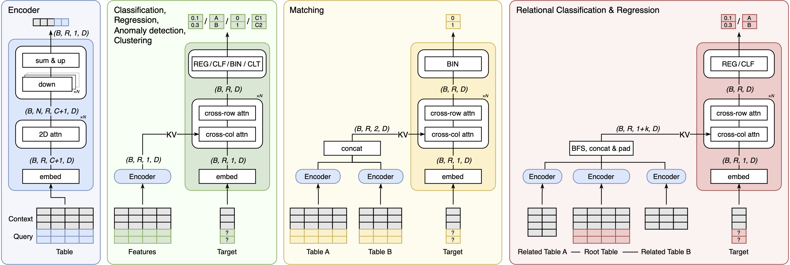

# FlexTab
[](https://openreview.net/forum?id=fOph6xxdyP) [](https://api.reuse.software/info/github.com/SAP-samples/flextab)


## Description

Implementation of the deep learning models with the inference pipeline described in the paper ["FlexTab: Towards a Flexible Encoder-Decoder Architecture for Tabular In-Context Learning"](https://openreview.net/forum?id=fOph6xxdyP).



## Abstract

We introduce FlexTab, a flexible encoder-decoder architecture for in-context learning on tabular data that combines a single, task-agnostic encoder with a suite of task-specific decoders. Unlike existing tabular in-context learners, which entangle feature representations with a specific prediction target, our design produces target-agnostic row embeddings that can be leveraged across a range of downstream tasks. We demonstrate this flexibility on three distinct tasks: classification, regression, and entity matching. We note that our architecture can be extended to problems such as outlier detection, clustering, and entity classification in relational databases, among others. Both the encoder and the task-specific decoders are trained on a large corpus of real-world, unlabeled tables. FlexTab achieves state-of-the-art or competitive performance across the examined tasks. Our results demonstrate that a single shared encoder, paired with task-specific decoders, can serve as an effective general-purpose backbone for diverse tabular prediction problems.

## Citations

If you use this model in your research or want to refer to our work, please cite:
```
@inproceedings{
    flextab,
    title={{FlexTab}: Towards a Flexible Encoder-Decoder Architecture for Tabular In-Context Learning},
    author={Marek Polewczyk and Maximilian Schambach and Marco Spinaci and Sam Thelin and and Johannes Höhne},
    booktitle={ICML 2026 Second Foundation Models for Structured Data Workshop},
    year={2026},
    url={https://openreview.net/forum?id=fOph6xxdyP}
}
```

## Requirements

This project uses model checkpoints available on git-lfs, that are automatically downloaded if git-lfs is installed.

The requirements are detailed in the `pyproject.toml` file for Python 3.12 version.

Local installation in virtual environment:
```bash
uv sync
source .venv/bin/activate
```

Installation from source:
```pip install git+https://github.com/SAP-samples/flextab.git```

## Basic Usage

The model supports classification, regression, and matching tasks. It accepts input data in the form of a pandas DataFrame or a NumPy array. No preprocessing is required, column names and cell values are automatically embedded using an LLM, and any missing values are handled correctly.

For best performance, use a GPU with at least 80 GB of memory and set the context size to 8192. For large tables, it is recommended to use a bagging factor of 8.

For a light-weight, faster model with lower requirements on the GPU, try lowering the context size to e.g. 2048 and set the bagging factor to 1.


### Basic test

To test the environment is correctly setup and do a basic end-to-end testing, run
```bash
uv run --extra test python test.py
```

It should return the following results:
```
CLASSIFICATION
Accuracy 98.60%
AUROC 99.92%

REGRESSION
R² Score: 49.62%

MATCHING
Accuracy 99.63%
F1 Score 98.89%
AUROC 99.96%

EMBEDDING
Self-context shape: (30, 768)
Context+query shape: (50, 768)
Context invariance max diff: 0.00e+00
```

### Classification

```python
from sklearn.datasets import load_breast_cancer
from sklearn.metrics import accuracy_score
from sklearn.model_selection import train_test_split

from flextab import FlexTabClassifier

# Load sample data
X, y = load_breast_cancer(return_X_y=True)
X_train, X_test, y_train, y_test = train_test_split(X, y, test_size=0.5, random_state=42)

# Initialize a classifier, 8k context and 8-fold bagging gives best performance, reduce if running out of memory
clf = FlexTabClassifier(max_context_size=8192, bagging=8)

clf.fit(X_train, y_train)

# Predict probabilities
prediction_probabilities = clf.predict_proba(X_test)
# Predict labels
predictions = clf.predict(X_test)
print("Accuracy", accuracy_score(y_test, predictions))
```

### Regression

```python
from sklearn.datasets import fetch_openml
from sklearn.metrics import r2_score
from sklearn.model_selection import train_test_split

from flextab import FlexTabRegressor

# Load sample data
df = fetch_openml(data_id=531, as_frame=True)
X = df.data
y = df.target.astype(float)

# Train-test split
X_train, X_test, y_train, y_test = train_test_split(X, y, test_size=0.5, random_state=42)

# Initialize the regressor, 8k context and 8-fold bagging gives best performance, reduce if running out of memory
regressor = FlexTabRegressor(max_context_size=8192, bagging=8)

regressor.fit(X_train, y_train)

# Predict on the test set
predictions = regressor.predict(X_test)

r2 = r2_score(y_test, predictions)
print("R² Score:", r2)
```

### Entity matching

`FlexTabMatcher` predicts whether two aligned tables describe the same entity row by row. Provide left/right context tables together with a binary `match` label, then call `predict_matching` on aligned test pairs:

```python
from sklearn.metrics import accuracy_score, roc_auc_score

from flextab import FlexTabMatcher
from flextab.utils.test_utils import load_febrl4

left_train, left_test, right_train, right_test, y_train, y_test = load_febrl4()

matcher = FlexTabMatcher(max_context_size=8192, bagging=1)
matcher.fit(left_train, right_train, y_train)
predictions = matcher.predict(left_test, right_test)
print(f'Accuracy {accuracy_score(y_test, predictions):.2%}')
# Probabilities (e.g. for thresholding or AUROC):
# probas = matcher.predict_proba_matching(left_test, right_test)
# print(f'AUROC {roc_auc_score(y_test, probas[:, 1]):.2%}')
```

## Known Issues
No known issues

## How to obtain support
[Create an issue](https://github.com/SAP-samples/flextab/issues) in this repository if you find a bug or have questions about the content.

## Contributing
If you wish to contribute code, offer fixes or improvements, please send a pull request. Due to legal reasons, contributors will be asked to accept a DCO when they create the first pull request to this project. This happens in an automated fashion during the submission process. SAP uses [the standard DCO text of the Linux Foundation](https://developercertificate.org/).

## License
Copyright (c) 2026 SAP SE or an SAP affiliate company. All rights reserved. This project is licensed under the Apache Software License, version 2.0 except as noted otherwise in the [LICENSE](LICENSE) file.
